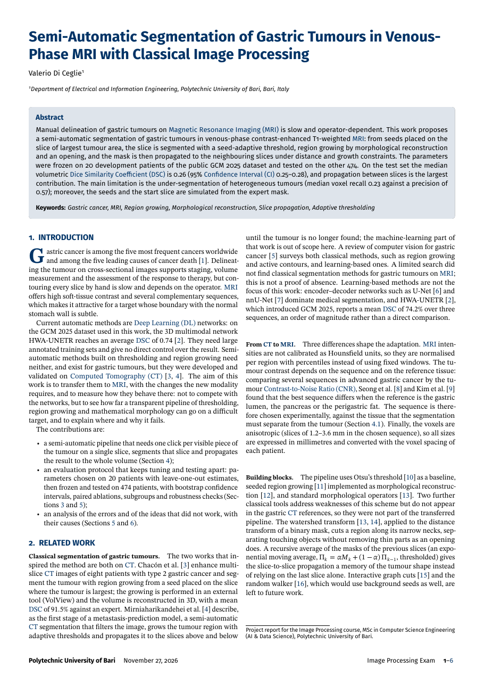
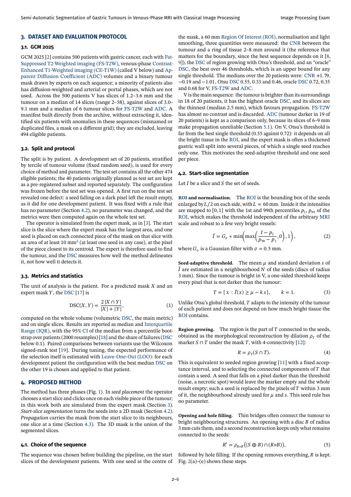
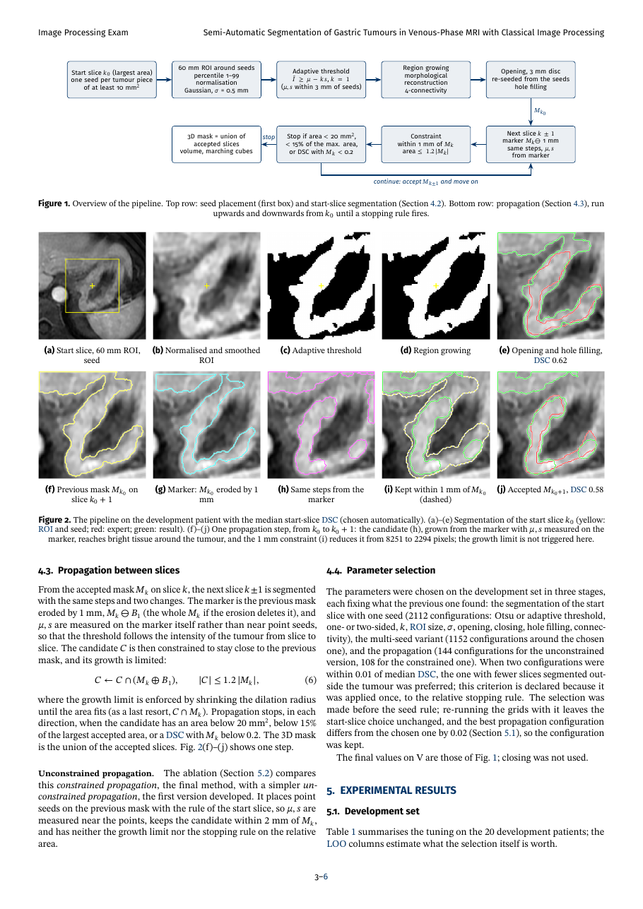
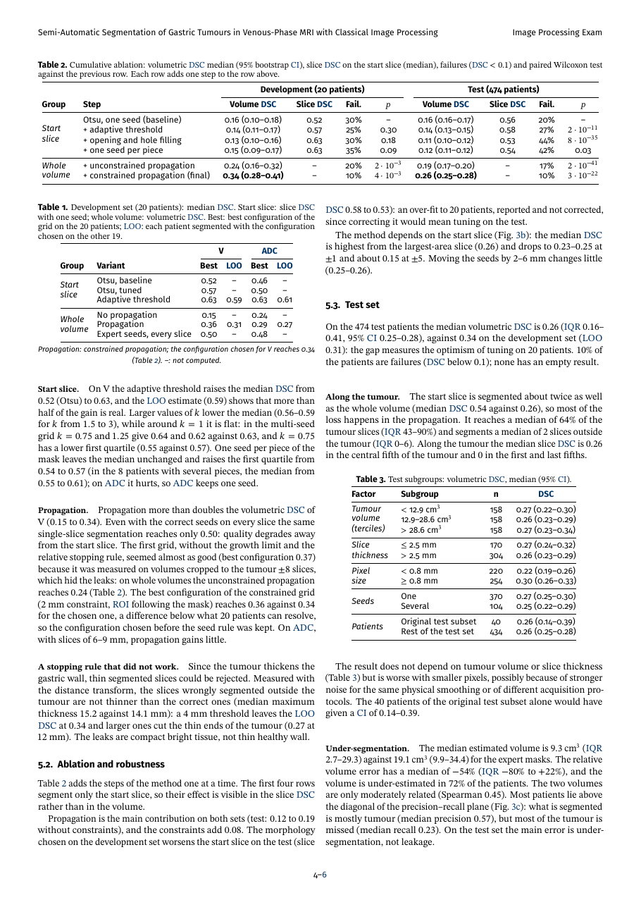
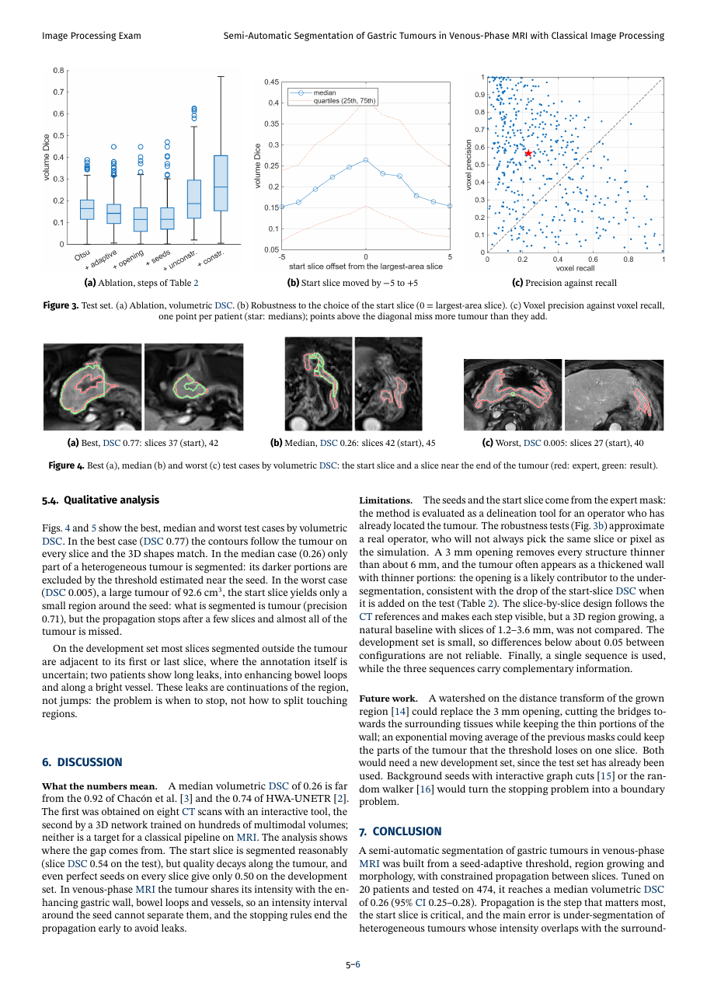
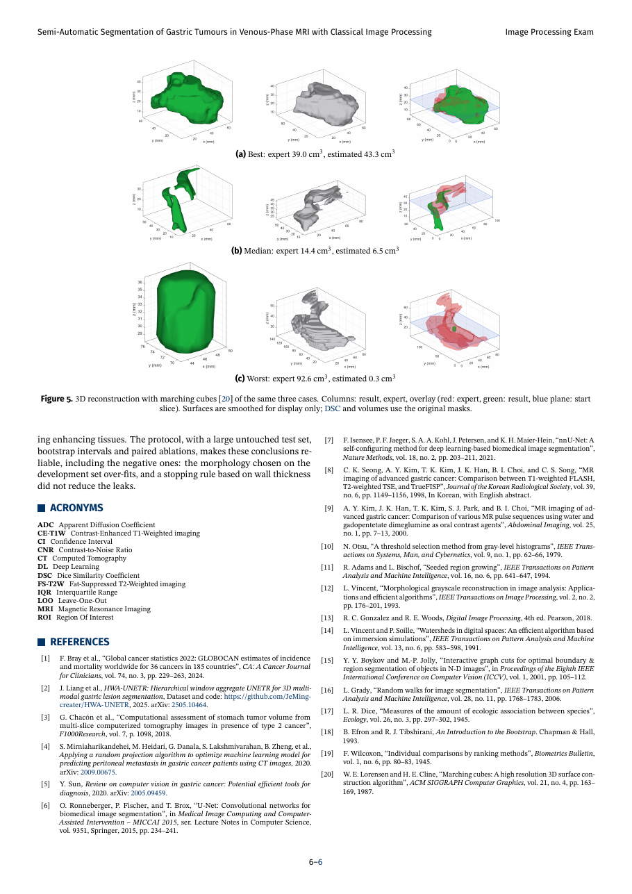

# Semi-Automatic Segmentation of Gastric Tumours in Venous-Phase MRI

Semi-automatic 3D segmentation of gastric tumours in venous-phase contrast-enhanced T1-weighted MRI
with classical image processing in MATLAB: a seed-adaptive threshold, region growing by morphological
reconstruction, morphology and constrained propagation of the mask between slices.
Image Processing exam project, MSc in Computer Science Engineering (AI & Data Science), Polytechnic University of Bari.

## Abstract

Manual delineation of gastric tumours on MRI is slow and operator-dependent. This work proposes a
semi-automatic segmentation of gastric tumours in venous-phase contrast-enhanced T1-weighted MRI: from
seeds placed on the slice of largest tumour area, the slice is segmented with a seed-adaptive threshold,
region growing by morphological reconstruction and an opening, and the mask is then propagated to the
neighbouring slices under distance and growth constraints. The parameters were frozen on 20 development
patients of the public GCM 2025 dataset and tested on the other 474. On the test set the median
volumetric Dice similarity coefficient (DSC) is 0.26 (95% CI 0.25–0.28), and propagation between slices
is the largest contribution. The main limitation is the under-segmentation of heterogeneous tumours
(median voxel recall 0.23 against a precision of 0.57); moreover, the seeds and the start slice are
simulated from the expert mask.

| Set | Patients | Volumetric DSC, median | Start-slice DSC, median |
|---|---|---|---|
| Development | 20 | 0.34 (leave-one-out 0.31) | 0.63 |
| Test | 474 | 0.26 (95% CI 0.25–0.28) | 0.54 |

## Report

The full report is [`report.pdf`](report.pdf).

<table>
  <tr>
    <td><a href="assets/report-1.png"></a></td>
    <td><a href="assets/report-2.png"></a></td>
    <td><a href="assets/report-3.png"></a></td>
  </tr>
  <tr>
    <td><a href="assets/report-4.png"></a></td>
    <td><a href="assets/report-5.png"></a></td>
    <td><a href="assets/report-6.png"></a></td>
  </tr>
</table>

## Requirements

- MATLAB (developed with R2026b) with the Image Processing Toolbox. The Statistics and Machine Learning
  Toolbox is not needed: the bootstrap and the Wilcoxon test are implemented in `src/`.
- Python 3 with the packages in [`python_tools/requirements.txt`](python_tools/requirements.txt), only to
  extract the data from the archive.

## Data

The GCM 2025 dataset (500 patients, gastric MRI with expert tumour masks) is not included in this
repository. It is described in Liang et al., *HWA-UNETR* (arXiv:2505.10464); see
[the authors' repository](https://github.com/JeMing-creater/HWA-UNETR) for access and terms of use.
Place the archive as `GCM2025.zip` in the parent folder of this repository, then run from the repository root:

```
python python_tools/extract_subset.py ../GCM2025.zip . dev V,T2_FS,ADC manifest/split_final.csv split_final
python python_tools/extract_subset.py ../GCM2025.zip . test V manifest/split_final.csv split_final
```

`extract_subset.py` copies only the needed volumes into `data/<split>/<id>/`, without extracting the whole
archive, and writes the list of cases read by MATLAB (`manifest/<split>_cases.csv`). It skips the files
already copied, so it can be re-run until it completes; the test set can also be extracted in blocks by
adding the first and last patient index (e.g. `0 120`).

The split used in the report is `manifest/split_final.csv`: 20 development patients, 474 test patients and
6 patients excluded for anomalies in their files. `manifest/manifest_modalities.csv` lists the files of every
patient in the archive; `build_manifest.py` rebuilds it from the archive, and `make_split.py` draws the
initial development set (20 patients stratified by tumour volume, fixed random seed). Neither is needed to
reproduce the results.

## Setup and execution

All commands run in MATLAB from the repository root.

```matlab
main            % runs all experiments in order (about 30 minutes);
                % tables and figures go to results/<experiment>/
checkPipeline   % after main: checks in about 1 minute that the method still reproduces
                % the saved development results; useful after any change to the code
```

To segment one patient with the final configuration:

```matlab
addpath('src');
[I, S, sp] = readCase('data/test/<id>/V_img.nii.gz', 'data/test/<id>/V_seg.nii.gz');
M = segmentCase(int16(I), S, sp);   % 3D tumour mask; seeds and start slice are taken from S
diceCoef(M, S)                      % volumetric Dice with the expert mask
```

`demo.m` shows the method on one development patient, one section at a time (Ctrl+Enter); right-click it
and choose "Open as Live Script" to run it as a notebook. It covers:

1. the method step by step: seed placement, normalisation, adaptive threshold (with its histogram),
   region growing, opening, one propagation step and the whole volume in 3D;
2. seeds placed by clicking on the slice, as an operator would, instead of taking them from the expert mask;
3. two sliders for the threshold parameter k and the opening radius, to see their effect on the start slice.

The parameters of the method are in `src/methodConfig.m`. The experiments called by `main`, in order:

| Experiment | Question |
|---|---|
| `checkDataset` | are the development cases readable and consistent? |
| `compareModalities` | which sequence to use: V, T2_FS or ADC? |
| `tuneStartSlice` | which threshold and morphology on the start slice, with one seed? |
| `tuneMultiSeed` | does one seed per piece of the tumour help? |
| `tunePropagation` | how to propagate the mask between slices (unconstrained and constrained)? |
| `tuneThicknessStop` | can the wall thickness stop the propagation? (no) |
| `ablationRobustness` | how much does each step contribute, and how robust is the method? |
| `analyzeTest` | results on the test set: subgroups, along the tumour, volumes |
| `analyzeSeedFallback` | final method with and without the rule for seeds on dark pixels |
| `renderTestCases3D`, `plotPipelineSteps` | figures of the report |

## Repository structure

```
main.m, checkPipeline.m   full run and quick check
demo.m                    interactive demo of the method on one patient
src/                      the method (segmentCase, segmentSlice, propagateVolume, methodConfig, ...)
                          and the shared tools (metrics, bootstrap, Wilcoxon test, I/O, figures)
experiments/              one experiment per file, run by main.m
python_tools/             data preparation only: extraction from the archive, manifest, initial split
manifest/                 split used in the report and list of the files in the archive
report.pdf, assets/       the report and its pages as images
```

## License

- Code (MATLAB and Python): [MIT License](LICENSE).
- Report (`report.pdf` and `assets/`): [CC BY 4.0](https://creativecommons.org/licenses/by/4.0/).
  It is typeset with the [rho class](https://github.com/MemoJimenez/Rho-class) by Guillermo Jiménez (CC BY 4.0).
- The GCM 2025 dataset is not covered by these licenses and keeps the terms of its authors.
